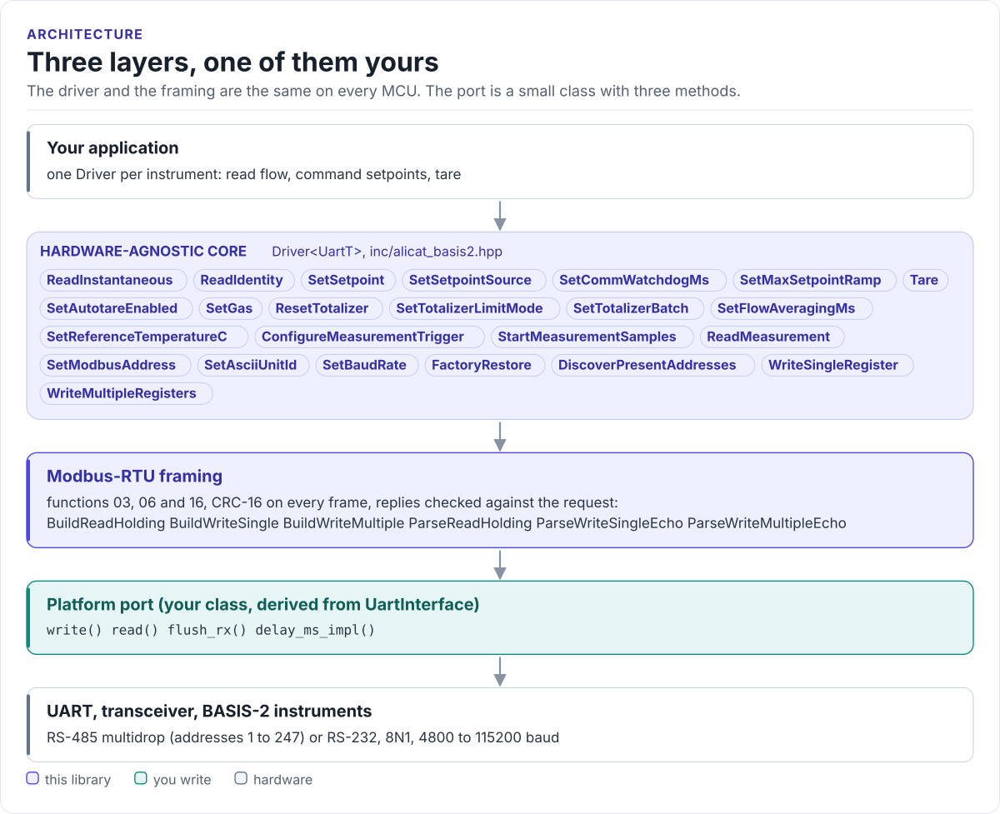

# Alicat BASIS-2 Driver

A C++17 driver for Alicat BASIS-2 mass flow meters and controllers: read flow, temperature and the totalizer,
command setpoints, tare and reconfigure the instruments over Modbus-RTU, from any MCU with a UART.

[](https://github.com/hardfoc/hf-alicat-basis2-driver/actions/workflows/ci-host-tests.yml)
[](https://github.com/hardfoc/hf-alicat-basis2-driver/actions/workflows/esp32-examples-build-ci.yml)
[](https://hardfoc.github.io/hf-alicat-basis2-driver/)
[](LICENSE)

**Documentation: <https://hardfoc.github.io/hf-alicat-basis2-driver/>**

<!-- figure: driver-layers -->
<picture>
  <source media="(prefers-color-scheme: dark)" srcset="docs/diagrams/driver-layers.dark.svg">
  
</picture>
<!-- /figure -->

## In 30 seconds

Write a small port class for your MCU (write, read with a timeout, flush;
[Porting](https://hardfoc.github.io/hf-alicat-basis2-driver/latest/porting/)), then:

<!-- generated: quickstart-code -->
```cpp
#include "alicat_basis2.hpp"

#include <cstdio>

int read_flow_once(MyUart& uart) {
  alicat_basis2::Driver<MyUart> meter(uart, 1);         // Modbus address 1, 200 ms timeout

  const auto id = meter.ReadIdentity();                 // 1. who is on the bus
  if (!id.ok()) {
    std::printf("no reply: %s\n", alicat_basis2::ToString(id.error).data());
    return -1;                                          // wiring, baud rate or address
  }

  const auto live = meter.ReadInstantaneous(3);         // 2. one request: registers 2100..2109
  if (!live.ok()) {
    return -1;
  }
  std::printf("SN %s  %s  flow %.3f %s  %.2f C\n", id.value.serial_number,
              alicat_basis2::GasShortName(live.value.gas).data(), static_cast<double>(live.value.flow),
              alicat_basis2::ToString(id.value.flow_units).data(),
              static_cast<double>(live.value.temperature_c));
  return 0;
}
```
<!-- /generated -->

## What it does

- Reads gas, status, temperature, flow, total, setpoint, valve drive and batch in one Modbus request
  (`ReadInstantaneous()`), and the instrument's identity (`ReadIdentity()`).
- Commands controllers: setpoint, setpoint source, communication watchdog, ramp, autotare, batch volume.
- Tares, resets the totalizer, selects one of the 9 calibrated gases, sets averaging and reference temperature.
- Brings up a bus: address sweep, address, unit ID and baud-rate changes, factory restore.
- One `Driver` per instrument; several share one RS-485 port.
- Header-only. No heap, no exceptions, no RTOS, no virtual calls (the port is a CRTP class).

## Install

```bash
git submodule add https://github.com/hardfoc/hf-alicat-basis2-driver.git external/hf-alicat-basis2-driver
```

```cmake
add_subdirectory(external/hf-alicat-basis2-driver)
target_link_libraries(my_app PRIVATE hf::alicat_basis2)
```

ESP-IDF: use the component wrapper in
[`examples/esp32/components/hf_alicat_basis2`](examples/esp32/components/hf_alicat_basis2/CMakeLists.txt).
Details: [Installation](https://hardfoc.github.io/hf-alicat-basis2-driver/latest/installation/).

## Documentation

| | |
| --- | --- |
| [Quickstart](https://hardfoc.github.io/hf-alicat-basis2-driver/latest/quickstart/) | Wire it, write the port, read flow |
| [Hardware](https://hardfoc.github.io/hf-alicat-basis2-driver/latest/hardware/) | Connector, bus settings, timing, power |
| [API guide](https://hardfoc.github.io/hf-alicat-basis2-driver/latest/api-guide/) | Read, command, tare, set up a bus, handle errors |
| [Modbus-RTU protocol](https://hardfoc.github.io/hf-alicat-basis2-driver/latest/modbus-protocol/) | Frames, registers and scaling |
| [Examples](https://hardfoc.github.io/hf-alicat-basis2-driver/latest/examples/) | ESP32-S3 applications |
| [API reference](https://hardfoc.github.io/hf-alicat-basis2-driver/latest/api/) | Doxygen, every class and member |

The pages are in [`docs/`](docs/index.md); the operation manual is in [`docs/datasheet/`](docs/datasheet/).

## Tests

```bash
cmake -S . -B build-host -DHF_ALICAT_BASIS2_BUILD_TESTS=ON && cmake --build build-host && ctest --test-dir build-host
```

The host tests run the driver against a model of a BASIS-2 Modbus slave; the code on the documentation site is
compiled by the same build.

## License

MIT. See [LICENSE](LICENSE). Not affiliated with or endorsed by Alicat Scientific.
