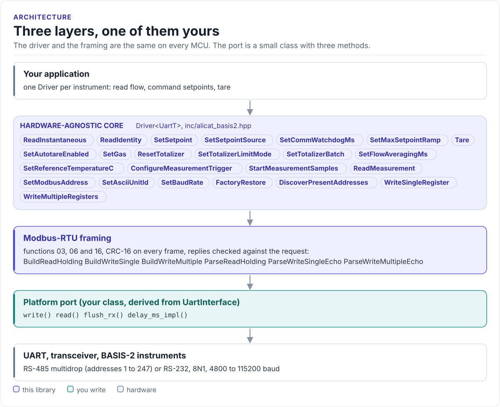
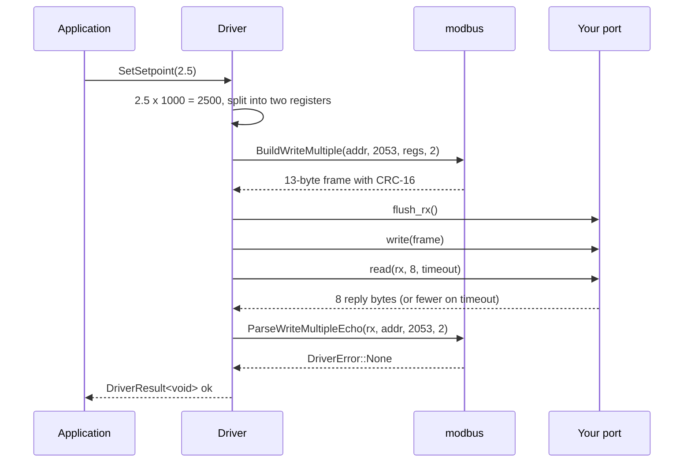

# Architecture

How the driver is put together: three layers, what each owns, and how one call reaches the instrument.

<!-- figure: driver-layers -->
<picture>
  <source media="(prefers-color-scheme: dark)" srcset="diagrams/driver-layers.dark.svg">
  
</picture>
<!-- /figure -->

## The three layers

| Layer | Where | You change it |
| --- | --- | --- |
| **Hardware-agnostic core**: `Driver<UartT>` | [`inc/alicat_basis2.hpp`](../inc/alicat_basis2.hpp) | Never, for a new board |
| **Modbus-RTU framing**: `alicat_basis2::modbus` | [`inc/alicat_basis2_modbus.hpp`](../inc/alicat_basis2_modbus.hpp) | Never |
| **Platform port**: your class | Your project | Once per MCU or board ([Porting](porting.md)) |

The core depends only on the port's methods; the framing depends on nothing. The port derives from
`UartInterface` in [`inc/alicat_basis2_uart_interface.hpp`](../inc/alicat_basis2_uart_interface.hpp) and calls
your SDK.

Everything above the port is the same on ESP32, STM32, a Linux host or the unit-test mock. That is how the
[host tests](testing.md) run the real driver code without hardware.

## How one call reaches the instrument

Every public call is one or more of these exchanges: flush, write the request, read the expected reply length
with the timeout, check it. A broadcast (address 0) write returns as soon as the request is written; no
instrument replies to it.

## Why CRTP

The port is a class template parameter, not a virtual base class. The compiler sees your port's methods
directly and inlines them; the driver has no vtable, allocates nothing and needs no RTTI. The cost is that the
driver type names the port: `Driver<MyUart>`. Code that has to work with several port types takes the driver as
a template parameter too.

## Results, not exceptions

Every call returns `DriverResult<T>` (a value and a `DriverError`) or a bare `DriverError`, and is `noexcept`.
`DriverResult` converts to `bool`, so `if (auto r = meter.Tare(); !r)` works. `ToString(DriverError)` gives a
stable name for logs without allocating. The [API guide](api-guide.md#handle-errors) lists what each error means.

## One driver per address

A `Driver` holds a reference to the port, one Modbus address and one timeout: three members, no buffers that
outlive a call. Several drivers can share one port, one per instrument on a multidrop bus. The driver does not
lock anything; one task must own the bus, or a mutex must guard every call ([Porting](porting.md#threads)).

## Source map

| Path | Contents |
| --- | --- |
| `inc/alicat_basis2.hpp` | `Driver<UartT>`: live data, identity, setpoint, tare, totalizer, measurement, bus configuration, raw access |
| `inc/alicat_basis2_types.hpp` | `DriverError`, `DriverResult<T>`, `Gas`, `FlowUnits`, `BaudRate`, decoded data structs, constants |
| `inc/alicat_basis2_registers.hpp` | Every register address the driver uses (`alicat_basis2::reg`) |
| `inc/alicat_basis2_modbus.hpp` | Frame builders and parsers for functions 03, 06 and 16, CRC-16 |
| `inc/alicat_basis2_uart_interface.hpp` | `UartInterface<Derived>`, the CRTP base of the port |
| `inc/alicat_basis2_version.h.in` | Version header template, filled in at configure time |
| `tests/` | Host unit tests and the compiled documentation snippets |
| `examples/esp32/` | ESP-IDF applications |
