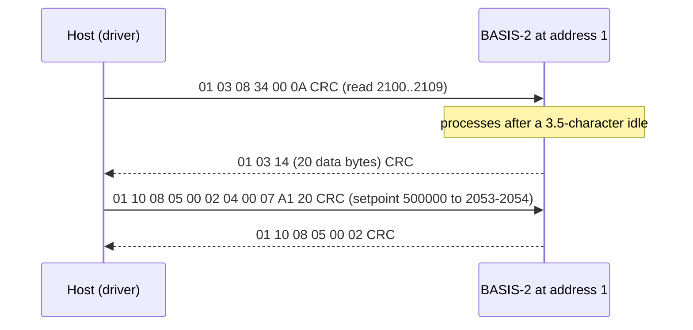

# Hardware

What to connect between your MCU and a BASIS-2, with which bus settings, and the wiring traps to avoid.

All values here come from the [BASIS-2 operation manual](datasheet/DOC-MANUAL-BASIS2.pdf) (Rev 4, May 2025) unless a
row says it is derived. The manual covers both B-Series meters and BC-Series controllers; rows marked
"controllers" do not apply to meters.

## Connector

Power and signals share the 6-pin JST-GH connector on top of the instrument.

| Pin | Signal | Notes |
| --- | --- | --- |
| 1 | Analog setpoint in, or tare | Controllers: setpoint input. Meters: hold to ground for 25 ms or more to tare |
| 2 | Analog out | 0 V to 5 V or 4 mA to 20 mA, linear in flow |
| 3 | Ground | Common to power, serial and analog signals |
| 4 | Power in | 12 V to 24 V DC |
| 5 | RS-232 Rx, or RS-485 B (+) | The model decides RS-232 or RS-485 |
| 6 | RS-232 Tx, or RS-485 A (−) | |

!!! danger "Power on pin 4 only"
    Power on any other pin can permanently damage the instrument. Do not connect the analog lines to a
    loop-powered 4 mA to 20 mA system: the manual says it destroys parts of the circuit; use a signal isolator
    and a separate supply.

## Wiring

=== "RS-485"

    { .hf-plate }

    | From | To |
    | --- | --- |
    | MCU UART TX | Transceiver DI |
    | MCU UART RX | Transceiver RO |
    | MCU GPIO or RTS | Transceiver DE and RE, tied |
    | Transceiver A | BASIS-2 pin 6 (A −) |
    | Transceiver B | BASIS-2 pin 5 (B +) |
    | MCU GND | Transceiver GND, BASIS-2 pin 3 |

    Any half-duplex 3.3 V transceiver works (SN65HVD11, MAX3485 and similar). The ESP32 examples use UART1 with
    TX on GPIO17, RX on GPIO18 and DE/RE on GPIO8 (RTS), with ESP-IDF's `UART_MODE_RS485_HALF_DUPLEX` driving
    the direction pin.

=== "RS-232"

    | From | To |
    | --- | --- |
    | MCU UART TX | RS-232 transceiver T1IN; T1OUT to BASIS-2 pin 5 (Rx) |
    | MCU UART RX | RS-232 transceiver R1OUT; R1IN from BASIS-2 pin 6 (Tx) |
    | MCU GND | Transceiver GND, BASIS-2 pin 3 |

    RS-232 is point to point: one instrument per UART. Use a level shifter (MAX3232 or similar); never connect
    pins 5 and 6 to 3.3 V logic directly.

## Bus settings

| Setting | Value |
| --- | --- |
| Frame | 8 data bits, no parity, 1 stop bit |
| Baud rate | 4800, 9600, 19200, **38400** (default), 57600, 115200 (register 21) |
| Modbus address | 1 to 247 (register 45); an out-of-range write sets 1 |
| Function codes | 03 read holding, 06 write single, 16 write multiple |
| Byte order | Big-endian registers; 32-bit values high register first |
| Response timeout | 200 ms, the driver default (`kDefaultTimeoutMs`); the manual gives no figure |

The manual does not state a factory Modbus address. Find it with `DiscoverPresentAddresses()` on a bus with one
instrument ([API guide](api-guide.md#find-and-readdress-instruments)).

## Timing

Modbus-RTU ends a frame with an idle gap of 3.5 characters, and a new frame must not start sooner. The driver
writes a request, then reads the reply; it does not insert a gap itself, so the port or the UART must leave it
([Porting](porting.md#rules-for-the-transfer)).

| Baud | Byte (8N1) | 3.5-char gap | Live-data exchange |
| --- | --- | --- | --- |
| 9600 | 1.04 ms | 3.65 ms | 34.4 ms |
| 19200 | 0.52 ms | 1.82 ms | 17.2 ms |
| 38400 | 0.26 ms | 1.75 ms | 8.6 ms |
| 115200 | 0.087 ms | 1.75 ms | 2.9 ms |

The live-data exchange is `ReadInstantaneous()`: an 8-byte request and a 25-byte reply. These figures are derived
from the baud rate and the Modbus over Serial Line specification (10 bits per byte at 8N1; a fixed 1.75 ms gap
above 19200 baud), not measured. The instrument's own turnaround comes on top; the manual does
not specify it.

## Power

| Instrument | Supply | Current |
| --- | --- | --- |
| BC-Series controller | 12 V to 24 V DC | 210 mA |
| B-Series meter | 12 V to 24 V DC | 12 mA |

Connect the MCU ground to pin 3. The analog output and the serial lines share that ground; long runs drop
voltage on it, so use a heavy ground wire when you also read the analog output.

## Status LED

| LED | Meaning |
| --- | --- |
| Solid green | Powered, no errors |
| Flashing green | Powered, serial activity |
| Fast red blink | Mass flow, temperature or totalizer over range (`MOV`, `TOV`, `OVR`) |
| Slow red blink | Valve hold or valve thermal management (`HLD`, `VTM`) |

## Process connections

| Model range | NPT | SAE |
| --- | --- | --- |
| 100 SCCM to 2 SLPM | 1/8" | SAE4 |
| 5 SLPM to 20 SLPM | 3/8" | SAE6 |

Mount the flow body horizontally with the flow arrow parallel to the ground; the maximum common-mode pressure is
145 PSIG. The manual suggests a 50 µm in-line filter and no pipe dope on the ports.

## RS-485 bus practice

These are general RS-485 rules, not from the Alicat manual:

- One twisted pair as a trunk, 120 Ω termination at both ends, short stubs to each instrument.
- Modbus addresses go to 247, but a standard transceiver drives 32 unit loads; check your transceivers' load
  rating before you put many instruments on one segment.
- Bias resistors (or a fail-safe transceiver) keep the idle bus in a defined state.

## Reference documents

| Document | What it is for |
| --- | --- |
| [BASIS-2 operation manual](datasheet/DOC-MANUAL-BASIS2.pdf) | Pinout, power, ASCII commands, Modbus register map |
| [Alicat manuals](https://www.alicat.com/manuals/) | Current manual revisions, BASIS 1 protocol |
| [Alicat Modbus FAQ](https://www.alicat.com/using-your-alicat/faq-modbus/) | Alicat's Modbus notes |
| [Modbus over Serial Line V1.02](https://modbus.org/docs/Modbus_over_serial_line_V1_02.pdf) | RTU framing, timing and CRC |
