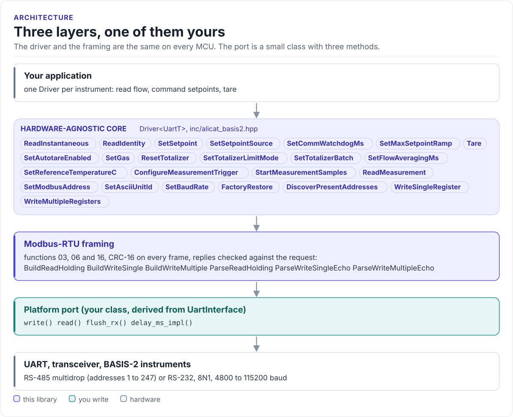

# Porting

Run the driver on a new MCU by writing one class: the serial interface.

The driver never calls your SDK directly. It calls three methods on a class you derive from
`alicat_basis2::UartInterface<Self>` (in
[`inc/alicat_basis2_uart_interface.hpp`](../inc/alicat_basis2_uart_interface.hpp)). The base class uses CRTP: the
calls are resolved at compile time, so there are no virtual functions, no vtable and nothing to allocate.

<!-- figure: driver-layers -->
<picture>
  <source media="(prefers-color-scheme: dark)" srcset="diagrams/driver-layers.dark.svg">
  
</picture>
<!-- /figure -->

## What you implement

| Method | Required | Contract |
| --- | :---: | --- |
| `write(const uint8_t* data, std::size_t length)` | yes | Send all `length` bytes; return once they are accepted by the UART (better: on the wire) |
| `read(uint8_t* out, std::size_t max, uint32_t timeout_ms)` | yes | Return when `max` bytes arrived or `timeout_ms` passed; the return value is the number of bytes in `out` |
| `flush_rx()` | yes | Discard every byte already received |
| `delay_ms_impl(uint32_t ms)` | optional | Sleep; `UartInterface::delay_ms()` calls it when present and does nothing otherwise |

The driver calls `flush_rx()`, then `write()`, then `read()` twice for every request: once for the first 3 bytes
of the reply, then for the rest. The first 3 bytes tell a normal reply from a 5-byte exception reply (bit 7 of the
function code), so the second `read()` asks for exactly the bytes still to come.

## The port

```cpp title="my_uart.hpp"
--8<-- "tests/docs/my_uart.hpp:port"
```

## Rules for the transfer

- **Wait for every byte asked for.** The driver asks for exactly the bytes it needs (3, then 2 for an exception
  reply, 5 for a write echo or 2 + 2N for a read of N registers). A `read()` that returns after the first chunk
  gives the driver a partial frame: `InvalidFrame` or `BadCrc` that come and go.
- **Return what you have at the timeout.** The return value must be the number of bytes that arrived; `0` is
  reported as `Timeout`.
- **Leave the 3.5-character gap.** A new request must start at least 3.5 characters (1.75 ms above 19200 baud)
  after the previous reply ended ([Hardware](hardware.md#timing)). A read that returns on the last byte followed at
  once by the next call's `write()` can break it; wait in `write()` if your UART does not.
- **Turn the bus around.** On RS-485, assert DE/RE for the request and release it right after the last stop bit,
  or the instrument's reply collides with your driver. Prefer the UART's hardware RS-485 mode (ESP-IDF
  `UART_MODE_RS485_HALF_DUPLEX`, STM32 `DEM`) over a GPIO toggled in software.
- **8N1 at the instrument's baud rate.** 38400 out of the factory.

## Reference implementation

The ESP32 examples define `EspUartAdapter` in
[`alicat_basis2_minimal_example.cpp`](../examples/esp32/main/alicat_basis2_minimal_example.cpp): ESP-IDF
`uart_write_bytes()`, `uart_read_bytes()` (which returns at `max` bytes or the timeout), `uart_flush_input()` and
`vTaskDelay()`, with UART1 in RS-485 half-duplex mode. Start from it for any ESP-IDF target.

## Check your port

1. Build it: the port on this page is compiled by the host CI from
   [`tests/docs/`](../tests/docs/my_uart.hpp), with the driver instantiated over it.
2. Call `ReadIdentity()`: a serial number that matches the label proves the whole path.
3. Call `ReadInstantaneous()` in a loop for a minute: no `BadCrc` or `InvalidFrame` on a healthy link.
4. Call a write the instrument rejects (for example `SetCommWatchdogMs()` on a meter): it should return
   `ModbusException` at once, with `GetLastException()` = `IllegalDataAddress`, not after the timeout.

## Threads

The driver is not thread-safe. Give the bus one owner task, or guard every call on every driver that shares a
port with one mutex. Instruments on separate UARTs can run in parallel.
